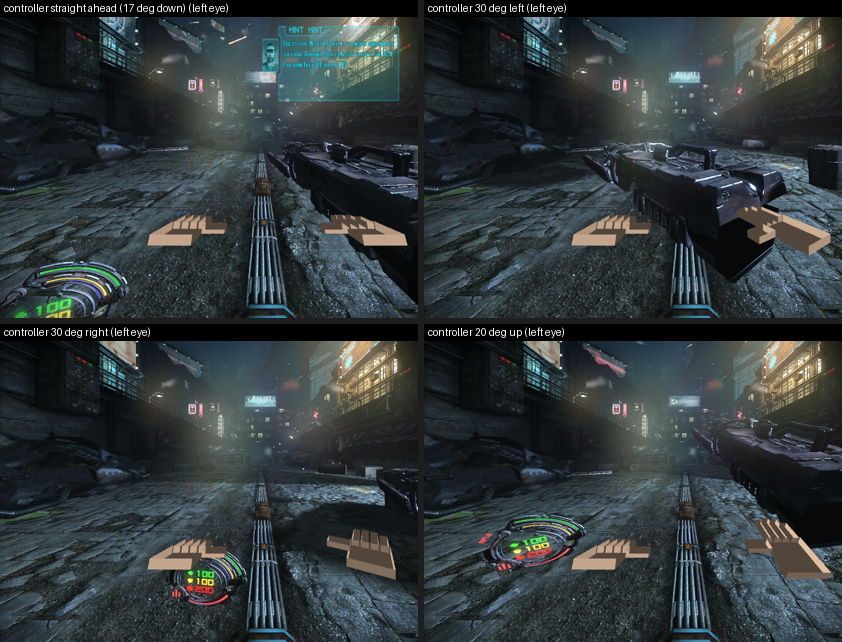

# 2026-10-16 (`/pd`-style, no game launched): the gun aimed by the controller, the view by the head — built, not yet run

Tefa: *"can you also use the same openxr simulator to see if you can get the gun turning independently of the camera? so
we can actually start on the whole 6dof roomscale movement"*. Same day as the hands (previous note).

## What the game does, and the one fact that decides the design

Hard Reset hangs the gun, its arms and its shots on the **game camera node**, which the mouse turns. Our head tracking
(2026-10-07) applied the head's turn ON TOP of that camera: view = GameView · T(−c) · R_head. So in VR today the gun
sits in front of the mouse direction and the head looks around it. That already is "the gun not following the
head": what Tefa wants is the gun following the **hand**, and the shots with it.

The gun's draw calls could be bent one by one (`mObjectToWorld`, VS c16–c18, shipped shader source), but then the
shots would still go where the camera points. The better lever is upstream: **turn the game camera itself to where
the controller points, and stop drawing from that camera.** Then the gun, the arms and the bullets all follow the hand
for free, because the game still believes the camera is the aim.

## The design (`src/hr_aim*.c`, staging `proxy-d3d9`, switch `d3d9_aim.txt`)

1. **Body frame.** When the switch goes on, the game camera's rotation of that frame is kept as R_B, fixed in the
   world (snap turns will move it later). The headset's LOCAL frame is identified with it.
2. **The view is drawn from the body:** view = T(−P) · R_B · T(−c) · R_head, with P the game camera's world position
   (the player's eye, still walking with the player) and c, R_head the head as before. The game camera's own rotation
   no longer moves the picture. (`aim_body_view`, called in `patch_camera` before the head turn.)
3. **The game camera is steered to the controller.** Each camera update: the game camera's forward (from the view the
   game just built) and the right controller's forward (the OpenXR **aim pose**, newly asked for beside the grip; the
   grip if a runtime has no aim pose), both expressed in the body frame, become yaw/pitch; the difference goes to the
   game as relative mouse movement (`SendInput`), proportional (70 % per frame, 300 counts max), with the game's
   counts-per-degree **learned** from what the previous frame's counts did (first sample taken whole, then an EMA).
   Mouse is sent only while the game's own window is in the foreground. (`aim_step`, after the camera patch.)
4. **No feedback loop by construction:** the body frame never moves with the camera, so "controller 30° left of the
   body" is one fixed target however far the camera has turned.

**Which step runs last (PROTOCOL §11):** the game reads this frame's mouse and builds the camera node, THEN slot 25
(our wrap) runs. So the mouse we send moves NEXT frame's camera (one frame of lag, 16 ms at 60), and the view we
replace is what THIS frame is drawn and culled with. Both are upstream of rendering: this is a fix, not an annotation.

## Proven without the game `[verified-numerically 2026-10-16, n=1]` (`test/hr_aim_math_test.c`, 16 checks)

- A controller turned 90° left reads as yaw +90; tipped 30° up as pitch +30; a game view at P turned 90° left gives P
  back and reads as 90° left of an unturned body; a body locked on that same camera reads it as straight ahead.
- Body view: a point 1 m ahead of the body stays 1 m ahead although the game camera turned 90°.
- The loop against a stand-in game (12 counts/°, mouse right = yaw down): reaches 40° left / 20° down within 40 frames
  (actually 5 moving frames), learns −12.00 / −12.00 counts/°, stops moving on target. Inverted pitch and 3× the
  sensitivity, target across the ±180° seam: converges. A target swinging 30°: worst lag 0.67°.
- The whole add-on builds (`d3d9.dll` `784237b0079d`), all older self-tests still pass.

## Not proven yet (needs the game: [FLAT], then the headset)

- That Hard Reset accepts `SendInput` relative mouse moves as look input while it has the focus (it takes `SendInput`
  text in its console `[verified-live 2026-10-07]`; raw-input mouse `s_mouse_raw_input` is a setting, and injected raw
  input does arrive as WM_INPUT, so the odds are good) `[hypothesis]`. If not: the second method is writing the
  player's own yaw/pitch (the camera node's source, still to be found statically; `s_mouse_sensitivity` and the pad
  look settings are the thread to pull).
- `s_mouse_smooth` may add lag; the loop tolerates it (it only learns from frames where the camera actually moved).
- The gun's POSITION stays at the eye (it is the game's camera-attached weapon); putting it at the hand is the
  next step (per-draw `mObjectToWorld` of the weapon draws, now that the orientation is right by the game itself).
- Roomscale: the body frame + head position already give room movement of the eye; the gun follows the hand's
  direction; what is missing after this is snap/smooth turn of the body frame and stick movement relative to the head.

## The first run, when Tefa launches the game (dev PC, simulator)

1. Game at gameplay, stereo on, `d3d9_openxr.txt`, `d3d9_head_track.txt`, `d3d9_hands.txt` on; aim OFF: the hands
   row's checks first.
2. Create `d3d9_aim.txt`: the log says `aim switched ON ... body frame = the next camera's rotation`. Move the mouse:
   **the gun swings but the world stays** (decoupled view). The `aim per s` line shows the camera yaw/pitch following
   the simulator's right controller (its default points straight ahead, so the camera returns to the body's forward).
3. `test/sim_hands_drive.py`-style controller commands for hand 1 with yaw/pitch: the gun turns to follow, the world
   does not; `aim per s` reports mouse sent > 0, error → 0, learned counts/° stable.
4. If the camera never moves: `mouse sent` > 0 but error stays → the game ignores injected mouse → method two.

## ⭐ FIRST LIVE RUN, same afternoon (dev PC, the game running, simulator; Tefa launched it): IT WORKS

Build `da3f75079a11`, `d3d9_aim.txt` created at gameplay (alley at the start). Recorded:
`hr-gun-aim-first_2026-10-16_15-51-24.mp4` (game window, 118 s) and `hr-gun-aim-first_second_...` (simulator
preview), MEGA transfer `Videos\hard-reset-vr\`. Measured `[verified-live 2026-10-16, n=1]`:

- **The game obeys injected relative mouse (SendInput) as look input.** Within the first second the loop steered the
  game camera onto the simulator's default aim pose (17° down): 10 mouse frames, then error 0.0 / 0.1°.
- **Learned: −5.0 mouse counts per degree on both axes** (mouse right = turn right, mouse down = look down, at this
  install's sensitivity) after 3–10 samples; the guess of 10 was 2× off and corrected itself.
- **Steps:** controller 30° left, 30° right, 20° up: the camera reached each to 0.1° within ~10–12 mouse frames
  (~0.2 s) and stayed. 
- **Decoupled view confirmed by eye on the pictures:** the street, buildings and signs stay exactly in place in all
  four; the gun, its HUD dial and our blocky right hand turn with the controller.
- **Smooth sweep:** controller round an oval (yaw ±25°, pitch ±12°, a lap per 5 s, 30 commands/s) for 12 s: worst
  sampled error 2.3° yaw / 1.0° pitch (one sample a second, the loop's one-frame lag on a moving target), ~70 mouse
  frames a second.
- **One shot fired** (left click via SendInput, game in front) with the controller 30° left. The picture a second later
  and a contact sheet of the video show no flash or mark at that size: whether the shot left along the hand is NOT yet
  checked `[hypothesis]` (frame-by-frame look at the video, or a run aimed at a wall).
- Hands in the game for the first time: ~150 eye pictures a second with hands, 0 failures; grip and aim poses found
  60/s each.

Switch put back off afterwards (`d3d9_aim.off`), game left running. What it means: **the gun and the game's own aim
follow the hand while the view is fixed to the body and the head**. Next: the gun's POSITION at the hand (it still
swings round the eye), turning the body (snap turn on the stick), walking relative to the head, and the shot check.
