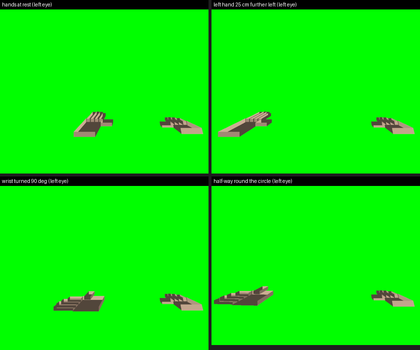

# 2026-10-16 (dev PC, no game launched): our own VR hands, drawn by the add-on, first light on the simulator

Tefa asked for VR hands in Hard Reset: *"have a crack at actually making vr hands for Hard reset in blender, import
them into the game and then create a program that is not for RE games, but something that is completely our mod"*.
Decision taken with Tefa the same day (*"our way is the way forward"*): **the hands are not the game's.** Our d3d9
stand-in draws them itself, into each eye's finished picture, at the controllers' places.

## Why not the game's own model system

The player's arms live in `data/characters/player/player.hkx` (Havok 6.6.0 packfile: `hkaSkeleton`, `hkxMesh`,
`hkxSkinBinding`, ragdoll) beside an 852-byte `player.rhs`; guns are `.rhs` (binary, no strings) and static items
`.rhm` `[inferred-static 2026-10-16]`. No public tool reads or writes either; a web look found nothing for
Road Hog's formats and only animation-side Havok tools for other games. The HUD screens are attached to
`arm02_attachment` / `main_attachment` of the player by `gameplay/base_templates/item/hud.nut` (the only script that
names those slots). Building a new skinned hand in those formats and feeding it controller poses through the game
would be months of guesswork before a first finger showed.

## What was built (staging `hard-reset-vr/proxy-d3d9`, compile-verified and run on the simulator only)

- **Controllers:** the headset thread now creates an action set with one grip-pose action per hand, bound for the
  Khronos simple, Oculus Touch, Valve Index, HTC Vive and WMR profiles, syncs it every frame and locates both grips in
  LOCAL space; the two poses travel in `HrPose.hand[2]` with the head pose (`hxr.c`).
- **Frame matrices:** the camera wrap keeps, per render frame, the exact matrices the frame was built with
  (`T(-c)·R_head` and both eye projections, plus the tracking origin and units) next to the pose, so anything we draw
  lands in the same world as the game's picture (`hr_head.c`, `HrFrameMats`).
- **The draw (`hr_hands.c`):** just before each eye is captured for the headset, two meshes are drawn with the
  fixed pipeline (FVF XYZ|DIFFUSE, CPU-shaded, no depth test, everything restored by a state block): model →
  `R(hand)^T · T(hand_p − origin) · S(units)` → `ref_to_view` → `proj[eye]`. Meshes: `hand_left.obj` /
  `hand_right.obj` beside the exe (metres, OpenXR grip frame, Blender's default Y-up/−Z-forward export), the right
  mirrored from the left if missing, else a built-in blocky hand (palm, four fingers, thumb, ~15 cm).
- **Switch:** `d3d9_hands.txt` beside the exe; `d3d9_vr.ini [hands] fake=1` puts stand-in controllers 40 cm ahead
  of the head when none is tracked; `scale=`, `colour=`.

## Measured `[verified-numerically 2026-10-16, n=1]`

- Pure maths test (`hr_hands_math_test`, 19 checks): blocky mesh 72 triangles, thumbs on +X (left) / −X (right); OBJ
  cube → 12 triangles, 24 points, mirror negates X only; model matrix places a fingertip right after a 90° turn; a
  hand hung off the head keeps its spot on the eye when the head turns 90°; parallax of a hand 40 cm ahead with 64 mm
  IPD = 0.155 ndc, as geometry says.
- No-game simulator run (`d3d9_selftest.exe xr <sim-32 json> big hands`): session runs, **controllers ON (5 of 5
  families accepted)**, the simulator supplies real controller poses (stand-ins never used), **60 eye pictures per
  second with hands, 0 draw failures**; preview photo shows both hands in both eyes with the thumbs on the right
  sides. The eye-to-eye shift in the raw eye images is 0.63 ndc = 0.155 parallax + 0.48 from the Quest 3 lens being
  asymmetric (−54°/+40°), which the compositor undoes; the maths is right.

## ⚠️ Found on the way: a 64-bit OpenXR layer registered under HKCU breaks every 32-bit OpenXR game on the PC

Hand Freeze's installer registers its 64-bit layer manifest under `HKCU\Software\Khronos\OpenXR\1\ApiLayers\Implicit`.
Windows does not split HKCU by bitness, so Hard Reset's 32-bit loader also finds it, cannot load the 64-bit dll
(error 193), and **xrCreateInstance fails with XR_ERROR_FILE_ACCESS_ERROR (−32)** `[verified-numerically 2026-10-16,
n=2]`: with loader 1.0.10 (the one shipped beside hardreset.exe) AND with Khronos' newest 1.1.63 (tried from the
official release zip; "skipping layer" is logged and the instance still fails). `DISABLE_HAND_FREEZE_LAYER=1` in the
environment makes it work again (the loader honours the manifest's `disable_environment` before loading the dll).
Window View registers two manifests the same way and has the mirror-image problem for 64-bit games. **The fix belongs
in those two tools:** register per bitness under HKLM (`SOFTWARE\Khronos\...` for 64-bit, `SOFTWARE\WOW6432Node\
Khronos\...` for 32-bit, which Windows itself keeps apart), which needs one administrator prompt. Rows on both boards.
Until then, any 32-bit OpenXR game on a PC with Hand Freeze registered needs that environment variable, or Hand
Freeze's layer switched off.

## Next

1. [FLAT] The same build in the game (installed, `d3d9_hands.txt` on): blocky hands where the simulator's
   controllers are, in both eyes, moving with the game camera. Then with depth (occluded by walls): find the scene
   depth surface of each eye and bind it for the draw.
2. [USER] The real hand, in Blender, together, one step at a time, exported as `hand_left.obj`.
3. [PD] Hand Poser's second mode: our own bones (wrist, five fingers × 3) in a shared-memory channel to this
   add-on, the mesh skinned on the CPU; the same window, sliders and builds as the RE version.
4. [PD] Hand Freeze / Window View: per-bitness layer registration.

## Correction, later the same day: the cause was a STALE registration, not HKCU itself

Supersedes: this file, section "Found on the way" (the "fix belongs in those two tools: register per bitness under
HKLM" conclusion), and the matching rows on the Hard Reset and Window View boards.

Checked: Hand Freeze v3.1 (2026-10-14) already registers a 32-bit copy of its layer beside the 64-bit one, and the
OpenXR loader skips a layer it cannot load as long as another one loads. On the dev PC only the 64-bit copy was
registered because **ON had last been pressed before v3.1 was installed**; nothing re-registers on an update. With the
32-bit copy registered as well (the same registry entry v3.1's ON makes), Hard Reset's own loader 1.0.10 logs
"skipping layer ... error 193" for the 64-bit copy and **the session runs: `d3d9_selftest.exe xr <sim-32> secs=5`
passes 14 of 14 with no environment variable** `[verified-numerically 2026-10-16, n=1]`. So the earlier n=2 result
("fails with 1.0.10 and 1.1.63") was measured with a one-copy registration, and the per-bitness HKLM rewrite (an
administrator prompt on every ON/OFF) is not needed.

What changed instead: **Hand Freeze v3.2 and Window View v1.1** check the registration against the files beside the
exe each time the app opens and re-do the ON press when they do not match (the 32-bit copy present but not registered,
or a manifest missing). Verified on the dev PC: with the stale one-copy registration restored, opening v3.2 registered
the 32-bit copy within 3 s `[verified-numerically 2026-10-16, n=1]`. Both copies are now registered on the dev PC, so
Hard Reset starts with Hand Freeze ON and needs no `DISABLE_HAND_FREEZE_LAYER`. The home PC needs the same: install
v3.2 and open it once (owed item raised).

## Later the same day: the hands MOVE with the controllers (simulator, recorded on video)

Tefa asked for the hands to be seen moving, using the simulator. The OpenXR Simulator takes controller commands
through a small file (`controller_pose_command.json`: hand, position, yaw, pitch; the position is relative to the head,
and the file channel takes about 15 commands a second). `test/sim_hands_drive.py` (staging `proxy-d3d9`) runs the
no-game self-test with the hands on, drives the LEFT controller and photographs the simulator's preview.

Measured `[verified-numerically 2026-10-16, n=3 runs each]`:
- **Nine positions and two wrist turns:** 25 cm left, 25 cm up, 25 cm right, 25 cm down, 15 cm nearer (bigger), 30 cm
  farther (smaller), wrist turned 90° about the up axis (fingers point left), wrist tipped 60° down, then the head moved
  50 cm right (the hand goes with it, the picture stays the same). In every photo the hand's measured centre sits within
  a few per cent of the eye width of the spot the add-on's own numbers predict, in BOTH eyes; the right hand never
  moves. 
- **A circle, continuously:** 20 cm radius, one lap every 6 s, ~15 commands/s for 14 s, with the wrist turning: the
  add-on's once-a-second positions trace the circle (x −0.40…0.00, y 1.22…1.58 around (−0.20, 1.40)) and the photos'
  hand centres go round with it. No drop-outs: 60 eye pictures with hands every second, 0 draw failures.
- **Videos (Tefa asked for it on film):** `hands-move-steps_2026-10-16_14-51-09.mp4` (33 s) and
  `hands-move-circle_2026-10-16_14-53-09.mp4` (20 s), 1280×720 60 fps, in the MEGA transfer folder's
  `Videos\hard-reset-vr\`, recorded from the simulator's preview window (the self-test's own window is never shown).

So the whole chain works on the simulator: controller pose → action space → per-frame matrices → both eyes, moving.
What is still untested is the same inside the real game (the [FLAT] row) and the real headset.
